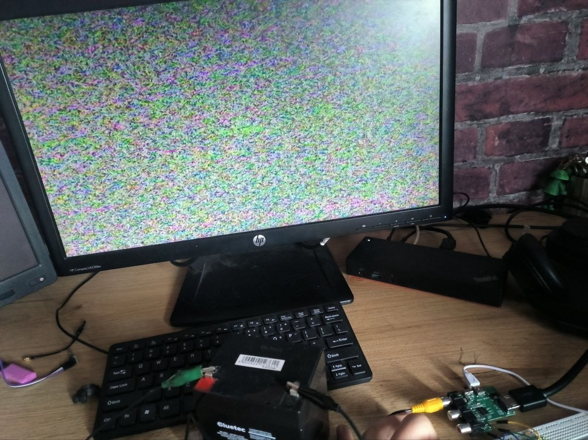
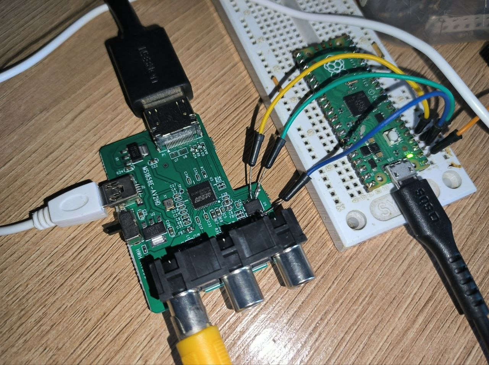

# MS1858E reverse engineering




CVBS/S-Video → HDMI converter IC (MacroSilicon MS1858E, QFN-48) with an on-die 8051, mask ROM, and a 2 KB I²C EEPROM (`24C16`) for customization.

This repo documents the EEPROM overlay, XDATA registers inferred from the 8051 code, working firmware patches, and MicroPython tools to dump/flash the EEPROM in-circuit.

**Patches and test status (live FPV CVBS→HDMI board, 2026-11-08):**

| Image | What it does |
|-------|----------------|
| [`firmware/stock.bin`](firmware/stock.bin) | Original dump |
| [`firmware/noblue.bin`](firmware/noblue.bin) | **Recommended for this setup:** no blue-screen fill on loss of lock; analog **snow** from the ADC; works when booting with the VTX off; no blue on drop or re-lock; ROM OSD text remains |
| [`firmware/noblue_skipe67a.bin`](firmware/noblue_skipe67a.bin) | Original skip attempt. **Did not reproduce on this board** (~1 s snow, then blue + "NO SIGNAL") |
| [`firmware/bootfix_skipe67a_fixed.bin`](firmware/bootfix_skipe67a_fixed.bin) | **Experimental:** boot-with-VTX-on handling. This build blue-screens when booting with the VTX off; a later v2 fixed that but still adds one blue frame on re-lock. Not recommended for VTX-off boot |

See [`docs/FINDINGS.md`](docs/FINDINGS.md) for what worked, what failed, and
the remaining limitations.

---

## Hardware / soldering

The MS1858E in **master** mode (pin `MCUSEL`) boots from an external **24C16** (2 KB, eight I²C blocks `0x50`–`0x57`).

You do **not** talk to the MS1858E itself for these tools. You bit-bang the EEPROM on the converter’s I²C bus.

### Raspberry Pi Pico (MicroPython)

| Pico | 24C16 | Notes |
|------|--------|--------|
| GP2 (I2C1 SDA) | SDA | 3.3 V logic |
| GP3 (I2C1 SCL) | SCL | 100 kHz |
| GND | GND | common ground |
| 3V3 | VCC | only if the module is **unpowered** and you supply the EEPROM |

**In-circuit (recommended):**

1. Power the converter from its own supply (or USB) so the MS1858E and EEPROM are at 3.3 V.
2. Solder three wires onto the EEPROM: **SDA, SCL, GND**.
3. If the MS1858E holds the bus after boot, **hold the converter in reset** (or power the board so the MCU is not mastering I²C) while the Pico dumps/flashes. Easiest reliable method: power the module, then **short/hold RST** on the MS1858E so only the EEPROM is on the bus — or dump with the converter unpowered and the Pico feeding 3.3 V + GND to the EEPROM only (watch for back-power through protection diodes).
4. 24C16 WP pin: tie to GND if writes fail.





### EEPROM map (I²C)

| I²C addr | EEPROM offset | Contents |
|----------|---------------|----------|
| `0x50` | `0x000–0x0FF` | Header + start of overlay |
| `0x51` | `0x100–0x1FF` | Overlay |
| `0x52` | `0x200–0x2FF` | Overlay |
| `0x53` | `0x300–0x3FF` | Overlay tail + checksums |
| `0x54–0x57` | `0x400–0x7FF` | `0xFF` (unused) |

---

## Tools (MicroPython on the Pico)

Copy scripts onto the Pico filesystem together with the `.bin` you want to flash.

| Script | Role |
|--------|------|
| [`tools/dump_eeprom.py`](tools/dump_eeprom.py) | Read 2048 bytes → `ms1858e_eeprom_backup.bin` |
| [`tools/flash_eeprom.py`](tools/flash_eeprom.py) | Write a 2048-byte image, then verify |

Edit `FILENAME` at the top of `flash_eeprom.py` (`noblue.bin`, `noblue_skipe67a.bin`, `stock.bin`, …).

Host-side (CPython) to rebuild patches from stock:

```text
python3 tools/build_patches.py firmware/stock.bin
```

After flashing, **power-cycle** the converter so the MS1858E reloads the EEPROM.

---

## Docs

| File | Contents |
|------|----------|
| [`docs/EEPROM.md`](docs/EEPROM.md) | Header layout, checksums, boot read order |
| [`docs/REGISTERS.md`](docs/REGISTERS.md) | XDATA / ROM entry points — **confirmed vs likely vs guess** |
| [`docs/OVERLAY.md`](docs/OVERLAY.md) | 8051 overlay hooks and control flow |
| [`docs/PATCHES.md`](docs/PATCHES.md) | Byte-level patches and live test results |
| [`docs/FINDINGS.md`](docs/FINDINGS.md) | 2026-11-08 test log: boot fix, blue-frame cause, OSD limits, failed experiments |
| [`docs/overlay_disasm.asm`](docs/overlay_disasm.asm) | Full stock disassembly (`PC = EEPROM offset`) |
| [`docs/i2c_boot_capture.txt`](docs/i2c_boot_capture.txt) | Logic-analyzer I²C read log (8-bit address, no bank) |

---

## Architecture (short)

Same family pattern as MS2106/MS2107/MS2109:

- Mask ROM does the real video/HDMI work.
- EEPROM holds a Keil C51 **overlay** linked at CODE `0x0000` (EEPROM offset = PC).
- ROM calls fixed overlay addresses as hooks; overlay `LCALL`/`LJMP`s into ROM at `0xE4xx–0xE7xx`.
- Hardware registers are 8051 **XDATA** (`MOVX`), not EEPROM bytes.

**Do not poke random `E1xx` TVD registers.** There is no public AGC/slicer map for this chip. Live tests: forcing a valid standard into `E1F4` on loss of lock **blanks** the output (no snow). Leaving `E1F4 >= 7` and skipping ROM blue-fill (`E4FF`) **is** what produces ADC snow.

---

## Checksums (must match or ROM ignores the overlay)

```
header = sum(eeprom[0x0A .. 0x35]) & 0xFFFF     # big-endian at 0x40 + length
code   = sum(eeprom[0x40 .. 0x40+length]) & 0xFFFF
```

Stock: length `0x0310`, header `0x0B9A`, code `0xA34C` stored at `0x350`.
`bootfix_skipe67a_fixed`: length `0x0370`, header `0x0BFA`, code `0xE5A3`
stored at `0x3B0`.

---

## License / dumps

Original EEPROM contents are from a commercial module. Use for personal hardware research. MacroSilicon does not publish a register datasheet.
